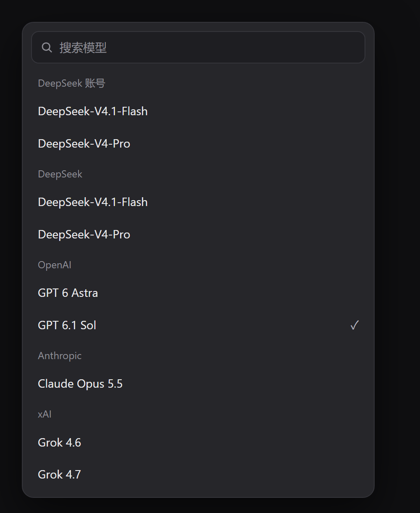
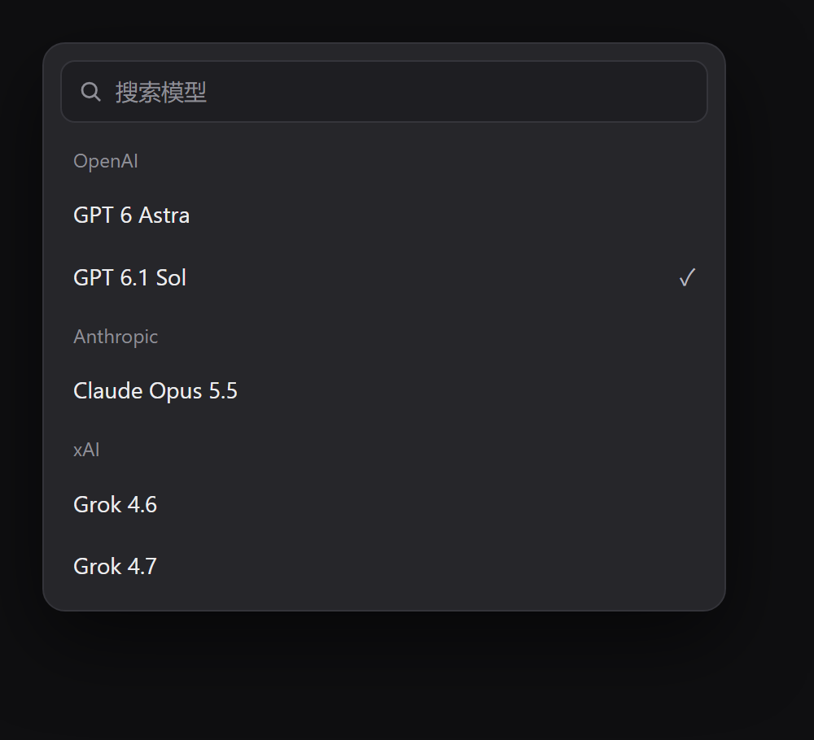
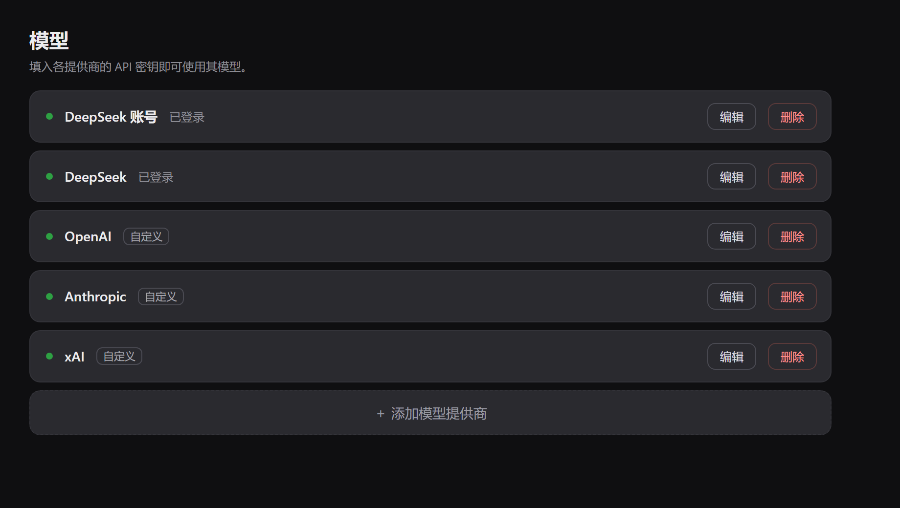
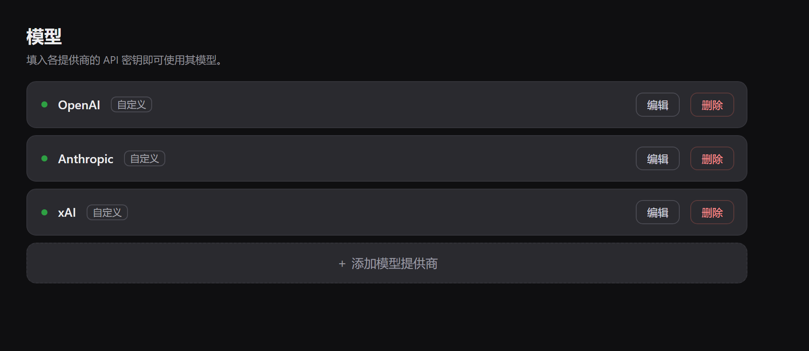
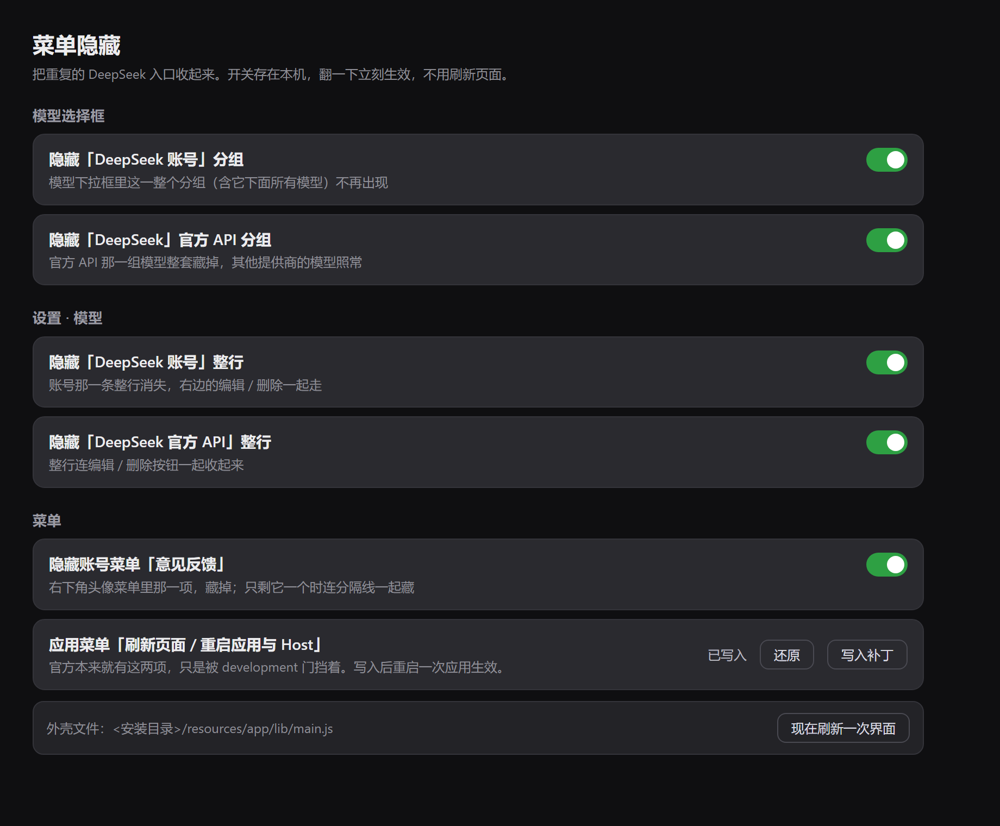
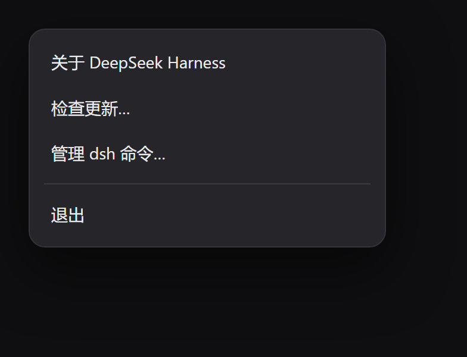
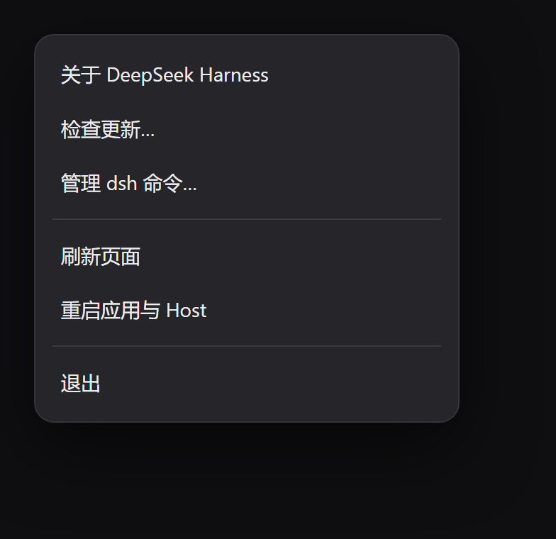
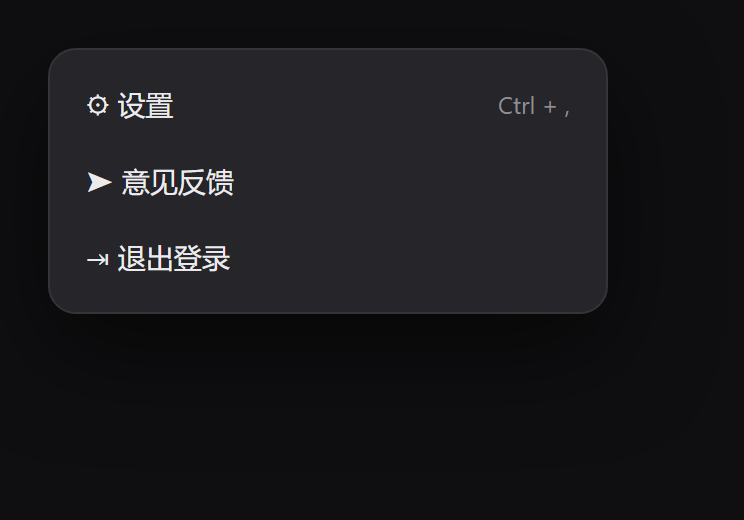
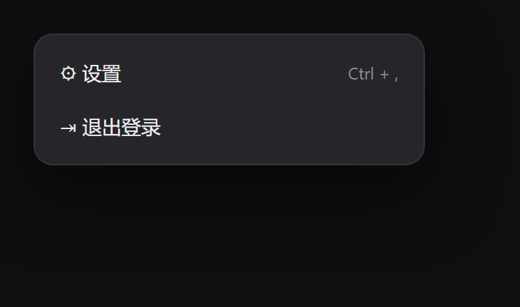

# dsh-menu-hidden · 菜单隐藏

DeepSeek Harness 插件。把界面上**重复的 DeepSeek 账号 / 官方 API 入口**收起来，顺手给应用菜单补上「刷新页面」「重启应用与 Host」。

开关在 **设置 → 菜单隐藏**，翻一下立刻生效，不用刷新页面。

## 效果

示意图，按真实界面的文案、分组顺序和配色复刻。图里的第三方厂商与模型都是随手编的示例名字（OpenAI 的 GPT 6 Astra / GPT 6.1 Sol、Anthropic 的 Claude Opus 5.5、xAI 的 Grok 4.6 / 4.7），不代表任何真实账号。

**模型下拉框** 左：装之前（DeepSeek 账号 / DeepSeek 两组重复） 右：装之后（只剩 OpenAI / Anthropic / xAI）

<p> </p>

**设置 · 模型** 左：装之前（两行 DeepSeek，其中一行带「已登录」） 右：装之后

<p> </p>

**设置 → 菜单隐藏**（插件自己的页面，六个开关逐个对应上面六条）

<p></p>

**应用菜单** 左：装之前 右：写入补丁并重启之后

<p> </p>

**账号菜单** 左：装之前 右：装之后

<p> </p>

## 装

`--profile` 后面写你要装进哪个 profile。桌面版和浏览器版是两个 profile，各装各的，也可以都装。

| 你用的形态 | profile 名 | 装完怎么生效 |
|---|---|---|
| 桌面应用（Electron，`DeepSeek Harness.exe`） | `desktop` | 重启应用；第 5 条还要在设置里点一次「写入补丁」，再重启一次 |
| 浏览器版 `dsh web` | `web` | 重启 `dsh web` 进程，然后刷新页面 |

桌面版：

```bash
dsh plugin --profile desktop add github:Biu-Bong/dsh-menu-hidden

# 锁到某个提交，升级不漂移
dsh plugin --profile desktop add github:Biu-Bong/dsh-menu-hidden#<commit-sha>
```

浏览器版：

```bash
dsh plugin --profile web add github:Biu-Bong/dsh-menu-hidden

# 装完重启 web 进程
dsh web --profile web
```

`dsh` 是 DSH 自带的 CLI（应用菜单「应用 → 管理 dsh 命令…」会把 dsh 写进 PATH）。
装完**重启一次**：bundle 的挂载行（`dsh.profile.bundles`）是启动时读的。

卸载：

```bash
dsh plugin --profile desktop remove dsh-menu-hidden
dsh plugin --profile web remove dsh-menu-hidden
```

也可以把仓库地址交给 DSH 助手，一句话：`装一下 github:Biu-Bong/dsh-menu-hidden`。

## 支持范围

| 功能 | 桌面版 | `dsh web` |
|---|---|---|
| 1 / 2 / 3 / 4 / 6（模型下拉框、设置·模型、账号菜单那五条） | ✅ 翻开关立刻生效 | ✅ 翻开关立刻生效 |
| 5（应用菜单「刷新页面 / 重启应用与 Host」） | ✅ 点「写入补丁」+ 重启应用 | — 浏览器里没有原生应用菜单 |

为什么 web 端也能跑：客户端半用的是 Web UI 的 DOM 和 slot，`package.json` 里 `dsh.client.platform` 就是 `"web"`，桌面版加载的也是同一套 Web 前端；宿主半只要求 `webServer` 服务，`web` profile 里也有。第 5 条走的是 Electron 主进程的 `Menu.buildFromTemplate(...).popup()`，浏览器里没有承载物——这种环境下宿主半找不到 `lib/main.js`，设置页那一行会显示「没找到外壳文件」，点按钮只会回一句说明，不会动到任何文件。

## 六条功能与实现

| # | 效果 | 实现方式 | 生效时机 |
|---|---|---|---|
| 1 | 模型选择框里隐藏「DeepSeek 账号」分组 | 客户端 DOM：`section[data-menu-group]` 按标题文字整组隐藏 | 立刻 |
| 2 | 模型选择框里隐藏「DeepSeek」（官方 API）分组 | 同上 | 立刻 |
| 3 | 设置 · 模型里隐藏「DeepSeek 账号」后面的「已登录」 | 客户端 DOM：只隐藏 `[class*="_accountStatus"]` 徽标，行还在 | 立刻 |
| 4 | 设置 · 模型里隐藏「DeepSeek」官方 API 那一行 | 客户端 DOM：隐藏该行 `<li>` | 立刻 |
| 5 | 应用菜单「退出」上方加「刷新页面」「重启应用与 Host」 | 宿主半：给 `lib/main.js` 的 `applicationItems()` 打开官方留着的 `development` 门（幂等、留备份 `.menuhidden.bak`、可还原） | 改完**重启一次应用** |
| 6 | 账号菜单里隐藏「意见反馈」 | 客户端 DOM：按文字认菜单项，藏掉（只剩它一个时连容器一起藏） | 立刻 |

## 为什么第 5 条要动外壳文件

官方本来就有这两项，写在 `lib/main.js` 的 `applicationItems()` 里：

```js
...development ? [
  { type: "separator" },
  { label: messages.reloadPageMenu, role: "reload" },
  { label: messages.restartAppHostMenu, click: () => { app.relaunch(); quitWithoutConfirmation() } }
] : [],
```

打包版 `development = !app.isPackaged` 恒为 `false`，整段被丢掉。Windows 上「应用」菜单是点开时用 `Menu.buildFromTemplate(items).popup()` 现拼的**原生**菜单，浏览器端碰不到，所以只能在主进程那边把门打开：

```js
...(development || true) ? [
```

改完 `Menu` 下次启动才重建，所以那两项要重启一次应用才出现。插件把这件事做成了设置页上的两个按钮（写入补丁 / 还原），走一条本机路由，写入端带平台浏览器鉴权 —— 不带会话 cookie 的本机进程会被 401 挡回去。

外壳路径的找法依次是：`DSH_SHELL_MAIN_JS` 环境变量 → `process.argv[0]` 旁边的 `resources/app/lib/main.js` → `%LOCALAPPDATA%\Programs\DeepSeek Harness\...` → `%ProgramFiles%\DeepSeek Harness\...`。找不到就显示「没找到文件」，不动任何东西。

不想开界面也能从命令行来：

```bash
node shell/patch-shell-menu.mjs --status   # 看状态
node shell/patch-shell-menu.mjs --apply    # 写入
node shell/patch-shell-menu.mjs --revert   # 还原
```

## 设置页

设置 → 菜单隐藏：六个开关 + 两个按钮。

- 前五个开关：模型选择框两处、设置·模型两处、账号菜单一处。开关存 `localStorage` 的 `dsh-menu-hidden:v1`，翻一下立刻重扫 DOM。
- 「应用菜单」那一行显示外壳状态（已写入 / 未改动 / 没找到文件）+ 写入 / 还原按钮。
- 最后一行「现在刷新一次界面」，等同应用菜单里的「刷新页面」。

隐藏只改 `style="display:none!important"` 并在节点上打 `data-dshmh-hidden`（值 = 隐藏前的整个 `style` 属性），不删节点、不动 React props。关掉开关就把 `style` 原样还回去，随时可逆。

## 认节点的方式

| 位置 | 选择器 | 稳定性 |
|---|---|---|
| 模型下拉框分组 | `section[data-menu-group]` + `[data-menu-group-heading]` | 官方 MenuGroup 的 data 属性，稳 |
| 分组标题文字 | `DeepSeek 账号` / `DeepSeek Account`、`DeepSeek` | 官方 locale 与 provider displayName |
| 设置·模型 行名 | `[class*="_rowName"]`（Vite CSS Modules 的 `_hash_rowName`） | 用后缀，换版本不失效 |
| 已登录徽标 | `[class*="_accountStatus"]` | 同上 |
| 账号菜单项 | `[role="menuitem"]` 且文字是 `意见反馈` / `Feedback` | 官方菜单没有 data 属性，只能按文字 |

找不到就安静跳过，不抛错、不碰别的地方；三个 sweep 步骤各自 try/catch，一处结构变了不影响另外两处。

## 结构

```
package.json          # dsh.bundle.patch + dsh.client（platform: web）
cordis.patch.yml      # 挂载宿主半（外壳补丁路由）
index.js              # 宿主半：/dsh-menu-hidden/api/shell-menu，读写 main.js 补丁
client.js             # 客户端半：设置页 + DOM 隐藏 + MutationObserver
shell/patch-shell-menu.mjs  # 离线 CLI，同一对 MARK，同样幂等
```

## 卸载

```bash
dsh plugin --profile desktop remove dsh-menu-hidden
```

外壳补丁独立于插件存在：卸载插件不会把 `main.js` 改回去。要还原就先在设置页点「还原」，或跑 `node shell/patch-shell-menu.mjs --revert`。

## 排障：0.1.0 重启后打不开

0.1.0 有个致命 bug，症状是**装完重启 DSH 起不来**。崩溃日志（`%APPDATA%@deepseek-aidsh-desktoplogscrash-*-web-boot.log`）长这样：

```text
phase: running
Error: web boot: 1 entry did not activate
@local/dsh-menu-hidden: import failed: module is not defined
    at file:///<安装目录>/resources/app/lib/main.js:12492:15
```

原因：`client.js` 结尾写了 `module.exports = { ... }; return module.exports`。浏览器里的 `window.__ModuleLoader__` 只给 factory 传 `require`，**没有 CommonJS 的 `module`**；官方那些包能这么写，是因为打包器会在文件头上补 `var module = { exports: {} }` 两行，手写的 `client.js` 没有这层壳。于是模块在 import 阶段就抛 `ReferenceError: module is not defined`，整条客户端模块图判为未激活，前端直接起不来。

0.1.1 的修法是直接返回插件对象（cordis 认 `{ name, inject, apply }` 形状）：

```js
return { name: ID, inject: ["slots", "locale"], apply };
```

装了 0.1.0 的话，换成 0.1.1：

```bash
dsh plugin --profile desktop remove dsh-menu-hidden
dsh plugin --profile desktop add github:Biu-Bong/dsh-menu-hidden#v0.1.1
```

如果已经起不来、连界面都进不去：把 `profiles/<名字>/node_modules/dsh-menu-hidden` 挪走，并从同一个 `package.json` 的 `dsh.profile.bundles` 里删掉 `dsh-menu-hidden` 那一行，就能先启动；进了界面之后再装 0.1.1。

## License

MIT
