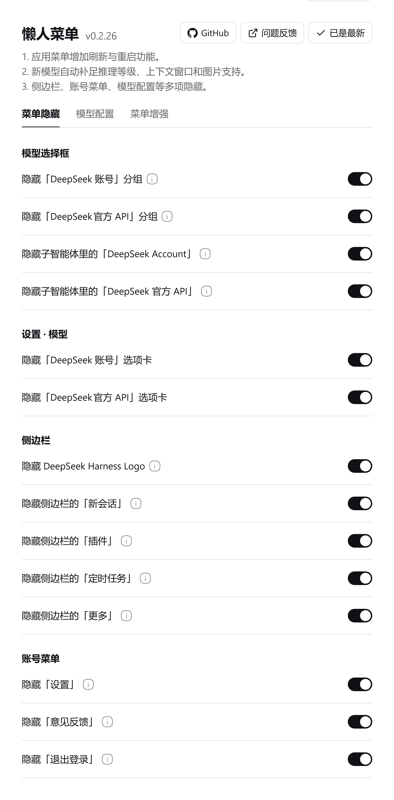
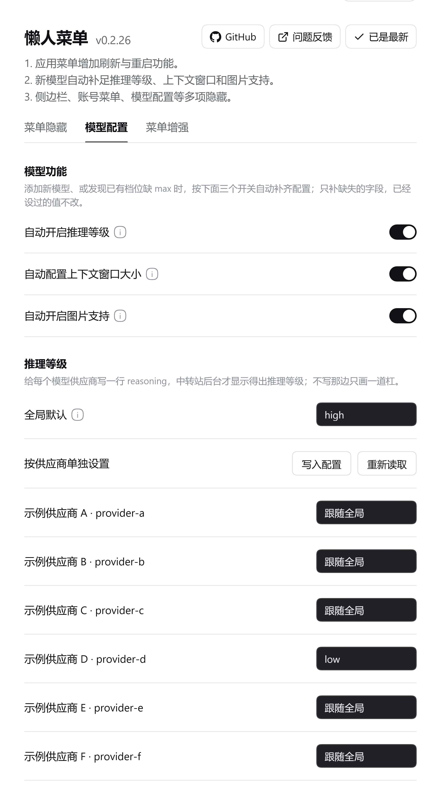
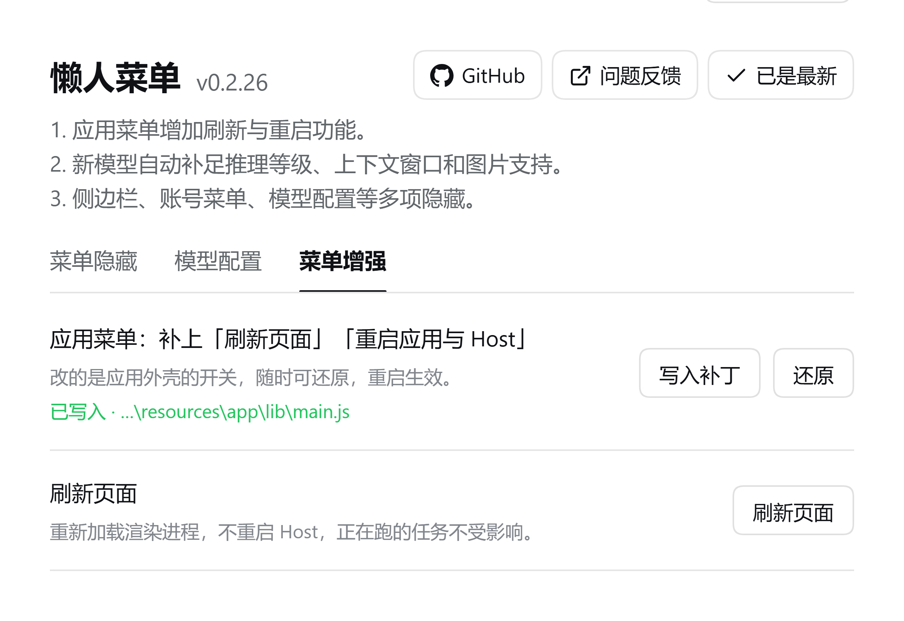

# dsh-menu-hidden · 懒人菜单

开关在 **设置 → 懒人菜单**，改完立刻生效，不用刷新页面。

1. 应用菜单增加刷新与重启功能。
2. 新模型自动补足推理等级、上下文窗口和图片支持。
3. 侧边栏、账号菜单、模型配置等多项隐藏。

## 截图

| 菜单隐藏 | 模型配置 | 菜单增强 |
|---|---|---|
|  |  |  |

> 截图里的供应商名称与 id 均为示例数据。

## 对应关系

| # | 要的效果 | 实现方式 | 生效时机 |
|---|---|---|---|
| 1 | 模型选择框里隐藏「DeepSeek 账号」分组 | 客户端 DOM：`section[data-menu-group]` 按标题文字整组隐藏 | 立刻 |
| 2 | 模型选择框里隐藏「DeepSeek」（官方 API）分组 | 同上 | 立刻 |
| 3 | 设置 · 模型里隐藏「DeepSeek 账号」整行 | 客户端 DOM：整行 `li` 藏掉（编辑 / 删除一起走），先用 `[class*="_accountStatus"]` 认出这是账号行 | 立刻 |
| 4 | 设置 · 模型里隐藏「DeepSeek」官方 API 那一行 | 客户端 DOM：隐藏该行 `<li>` | 立刻 |
| 5 | 应用菜单「退出」上方加「刷新页面」「重启应用与 Host」 | 宿主半：给 `lib/main.js` 的 `applicationItems()` 打开官方留着的 `development` 门（幂等、留备份 `.menuhidden.bak`、可还原） | 改完**重启一次应用** |
| 6 | 账号菜单里隐藏「意见反馈」 | 客户端 DOM：按文字认菜单项，藏掉（只剩它一个时连容器一起藏） | 立刻 |
| 7 | 账号菜单里隐藏「退出登录」 | 同上，两个开关各管一项，认不到就跳过 | 立刻 |

## 为什么第 5 条要动外壳文件

官方本来就有这两项，写在 `lib/main.js` 的 `applicationItems()` 里：

```js
...development ? [
  { type: "separator" },
  { label: messages.reloadPageMenu, role: "reload" },
  { label: messages.restartAppHostMenu, click: () => { app.relaunch(); quitWithoutConfirmation() } }
] : [],
```

打包版 `development = !app.isPackaged` 恒为 `false`，整段被丢掉。Windows 上「应用」菜单是点开时用 `Menu.buildFromTemplate(items).popup()` 现拼的原生菜单，浏览器端碰不到，所以只能在主进程那边把门打开：

```js
...(development || true) ? [
```

改完 `Menu` 在下次启动时才重建，所以那两项要重启一次应用才出现。插件把这个动作做成了设置页上的两个按钮（写入补丁 / 还原），走一条本机路由，写入端带平台浏览器鉴权 —— 不带会话 cookie 的本机进程会被 401 挡回去。

### 补丁会自己失效（0.2.28）

恒真的 `development || true` 有个后遗症：插件被卸载后它还在。因为 `dsh plugin remove` 走的是 pnpm，而 **pnpm 不执行依赖的 pre/post 生命周期脚本**（npm 那套在这里没有），插件拿不到「我要被删了」的通知，也就没有机会把 `main.js` 改回去 —— 用户看到的是插件没了、开发菜单还挂着。

0.2.28 起写进外壳文件的不是恒真值，而是每次启动现算的自检：

```js
...(development || (function(){try{
  const h = process.env.DSH_HOME || join(homedir(), ".dsh");
  for (const n of readdirSync(join(h, "profiles"))) {
    if (n.charAt(0) === "_") continue;
    if (existsSync(join(h, "profiles", n, "node_modules", "dsh-menu-hidden", "package.json"))) return true;
  }
  return false;
}catch{ return false }})()) ? [
```

| 场景 | 结果 |
| --- | --- |
| 插件装在某套 profile 里 | 菜单项出现 |
| `dsh plugin remove dsh-menu-hidden` | 下次启动菜单项自动消失，不用手动还原 |
| 重新装回来 | 下次启动又自动出现，不用再点「写入补丁」 |
| 只有 `_` 开头的探查 profile 里有 | 不算，不生效 |
| `DSH_HOME` 不存在 / 权限异常 / 外壳改了导入 | 退回 `false`，回到官方行为，不会把外壳带崩 |

自检只用 `main.js` 顶部本来就 import 了的 `existsSync` / `readdirSync` / `join` / `homedir`，不带新依赖，整段包在 try 里。想彻底拿掉补丁还是点「还原」，或跑 `node shell/patch-shell-menu.mjs --revert --file <main.js>` —— 还原是逐字节回到官方原文。0.2.26 / 0.2.27 写进去的恒真版本仍能被识别和还原，点一次「写入」会顺手升级成自检版。

## 推理等级（0.2.0）

各家中转站的后台只有在请求里带了推理等级时才显示得出来，DSH 只有在 provider 上写了
`reasoning: <level>` 才会带。手动给每个 provider 加一行、每加一个新供应商再加一次，很烦。

这个分区把这件事收成两档：

- **全局默认**：所有没单独设置的供应商都用这一档。
- **按供应商单独设置**：`跟随全局` / `不设置` / 具体档位（off, minimal, low, medium, high, xhigh, max）。

写入的是 profile 的 `cordis.patch.yml` 里 `- id: llm-pi-ai` → `config.providers.<id>.reasoning`：

- 纯行级编辑，注释、缩进、其它字段一个字不动；
- 幂等，值已经对了就不写盘；
- 写之前留 `cordis.patch.yml.menuhidden.bak`（每次写入都刷新，避免留着过期的旧备份）；
- 先写同目录临时文件再改名，写到一半中断也不会把配置截成半截 YAML；
- 只处理正式 profile（跳过 `_` 开头的探查 profile）；
- 状态存在 `$DSH_HOME/dsh-menu-hidden.reasoning.json`。

改完不用重启：模型配置是热读的（`llm-pi-ai` 监听 `internal/config`），下一条消息就带上新的推理等级。

### 自动补齐新供应商、新模型（0.2.21）

DSH 的推理菜单里第一项 `Default` 表示「不指定、用配置里的值」。中转站那边经常把「没指定」当成「关掉思考」，于是新加的供应商、新加的模型必须把默认档写死，不能留 `Default`。

插件在宿主半做这件事，开关是「自动补齐新供应商、新模型」（默认开）：

- 新供应商没有 `reasoning` → 按全局默认补一行；
- 新模型没声明当前档位 → 往它的 `reasoningEfforts` 里补一条（只加不改，手写的值一律不动，没有 `reasoningEfforts` 的非推理模型也不碰）；
- 触发方式是`fs.watch` 盯每个 profile **目录**（DSH 写配置是「临时文件 + rename」，盯文件会丢事件，盯目录不会），事件到了有 1.5 秒防抖；
- 兜底 60 秒 `stat` 一次，只比 `mtimeMs:size`，不读内容。实测每轮 0.11 ms，约占 0.0002% CPU；
- 写盘仍然是临时文件 + 改名、幂等、留备份；状态值没变就不重写状态文件。

### 隐藏推理菜单里的 `Default`（0.2.25）

再兜一层：开关「隐藏推理等级里的 `Default`」（默认开）会把推理菜单里文字正好是 `Default` / `默认` 的那一项整行藏掉（所在菜单里至少还要有别的档位才动手），模型列表里的行不受影响。这样即使某个供应商暂时没写档位，菜单里也不会出现 `Default` 让人误选。

## 设置页

说明文字走两种写法：「推理等级」是这一页里的第四个标题，和「模型选择框」「设置 · 模型」「账号菜单」用同一套样式（14px / 500），下面直接跟一行灰色小字说明；其余说明收进标题右边的 ⓘ，鼠标悬浮或 Tab 过去才浮出来。

设置 → 菜单隐藏，四个并列标题（模型选择框 / 设置 · 模型 / 账号菜单 / 推理等级）+ 底部两行外壳操作：

1. **模型选择框**：两开关，隐藏下拉框里的「DeepSeek 账号」分组 / 「DeepSeek」官方 API 分组。
2. **设置 · 模型**：两开关，管设置页里的两行 provider（账号选项卡 / 官方 API 选项卡）。
3. **账号菜单**：两开关，管右下角头像菜单里的「意见反馈」「退出登录」。账号菜单是另一处界面，所以单独成组，和「设置 · 模型」并列。
4. **推理等级**：全局默认（带 ⓘ）+ 按供应商覆盖，写入 profile 配置；面板重新获得焦点时会自动重读，也可以点「重新读取」手动刷出刚加的供应商。

推理等级里还有两个开关：「自动补齐新供应商、新模型」和「隐藏推理等级里的 `Default`」。

十三个开关都存 `localStorage` 的 `dsh-menu-hidden:v1`，翻一下立刻重扫 DOM。
- 「应用菜单」那一行显示当前外壳状态（已写入 / 未改动 / 没找到文件）+ 写入 / 还原按钮。
- 最后一行是「现在刷新一次界面」，等同应用菜单里的「刷新页面」。
- 「推理等级」是大类标题，不带 ⓘ；「全局默认」保留 ⓘ。
- 语言按应用当前语言走（中文 / English 两套齐全）。

隐藏只改 `style="display:none!important"` 并在节点上打 `data-dshmh-hidden`（值 = 隐藏前的整个 `style` 属性），不删节点、不动 React props。关掉开关就把 `style` 原样还回去，所以随时可逆。

## 语言：为什么有时候整页变英文

DSH 查字典用的是应用当前语言的**原样小写标签**：渲染进程的 locale 是 `zh-CN`（启动日志里 `locale: zh-CN` 那一行），查表键就是 `zh-cn`，查不到才沿回退链落到 `en`。只注册 `zh` 一份，就会掉进英文——看着像「插件没翻译」，其实是键没命中。

插件的做法（`client.js` 里的 `bindLocale()`）：

- 用单 locale 形式 `register(ns, locale, dict)` 注册 `zh` / `zh-CN` / `zh-Hans` / `en` 四份，标签怎么解析都能命中；
- 热重载时同一个 namespace 重复注册会抛 `already has locale`，抛了也照样继续 `bind`，不会退回「原样返回键名」；
- 应用是中文而字典只回了英文（或回了键名）时，补中文兜底。

回归测试：`test/locale.mjs`，模拟 DSH 的查表规则，断言 `zh-CN` / `zh-Hans` / `zh` 都出中文、`en` 出英文、重复注册后翻译函数仍然活着。

## 图标与列表标题

插件列表里那一行由两个文件决定，都不在 `client.js` 里：

| 元素 | 来源 |
|---|---|
| 图标 | `package.json` 的 `icon`（这里是 `./icon.svg`），配 `exports["./icon"]` |
| 标题 / 描述 | `locale/zh.json`、`locale/en.json` 的 `meta.title`、`meta.description`，按界面语言自动切换 |

```json
// locale/zh.json
{ "meta": {
    "title": "菜单隐藏 (dsh-menu-hidden)",
    "description": "添加重启和刷新菜单；侧边栏项目、官方模型分组、重复选项卡一键隐藏，可改默认推理等级（避免中转站取不到推理强度）。"
} }
```

三点经验：标题照 `中文名 (英文名)` 写，和「IM 机器人 (dsh-im)」那种条目排在一起才整齐；`meta.description` 只写用户能看见的结果（藏什么、加了什么菜单），别写实现；改完 `locale` 记得抬 `version`，否则清单缓存会继续用旧标题。

## 更新记录

- **0.2.28**：外壳补丁自愈。写进 `lib/main.js` 的条件不再是恒真，而是「插件还在不在」的运行时自检（扫 `$DSH_HOME/profiles/*/node_modules/dsh-menu-hidden/package.json`，跳过 `_` 开头）：`dsh plugin remove` 之后菜单项下次启动自动消失，重装又自动出现，不需要卸载钩子（pnpm 不执行依赖的 pre/post 生命周期脚本，本来也挂不上）。0.2.26 / 0.2.27 写进去的恒真版本仍能被识别、还原、并顺手升级。新增 `test/shell-selfcheck.mjs`（18 项断言，含「假 DSH_HOME 下表达式求值」与「apply/revert 逐字节还原」）；CLI 写入改为 `.menuhidden.tmp` + rename 原子替换，报告按写后重读的真实状态输出。
- **0.2.27**：启动安全。模块导出上不再写顶层 `inject`，改成 scoped `ctx.inject(...)` + 全程 try/catch —— 服务没到只降级（设置页不出现），entry 始终 active，不会再让整个前端卡在 `web boot: N entries did not activate`；配套新增 `test/client-degraded.mjs`。包补上 `repository` / `homepage` / `bugs`，`files` 补上 `shell/`。
- **0.2.26**：自动补齐从 5 秒轮询改成「目录事件 + 60 秒兜底 stat」，稳态 CPU 降一个量级；`fs.watch` 盯目录不盯文件，避开 rename 丢事件。
- **0.2.25**：新增「隐藏推理等级里的 `Default`」开关。
- **0.2.24**：修 0.2.23 把供应商列表渲染三遍的问题。
- **0.2.23**：自动补齐真正接上定时器；状态没变不重写状态文件。
- **0.2.21**：写入时核对每个模型是否声明了该档位，没声明的在提示里点名。
- **0.2.20**：刷新页文案收敛；`__ModuleLoader__.load` 包 try/catch，重复注册不再拖垮 web boot。
- **0.2.19**：「应用菜单」那一行改成三行（标题 / 说明 / 状态 + 路径）。
- **0.2.17**：图标改白底；列表标题与描述走 `locale/*.json` 的 `meta`（标题变成「菜单隐藏 (dsh-menu-hidden)」）；新增 `tools/install-local.mjs`（装进 profile 前校验包名、loader id、patch id 三处一致，含覆盖安装与体检模式）。
- **0.2.16**：把发布描述改成短句，补 `descriptionEn`。
- **0.2.15**：头部三颗胶囊（GitHub / 问题反馈 / 检查更新）；「已是最新」态；更新弹窗（运行版本、最新版本、目标 profile、手工命令、自动更新）。
- **0.2.14**：头部不再折行，版本号常驻。
- **0.2.13**：功能分组标题加粗。
- **0.2.12**：版本号与标题共享基线；外链不再跳两次。
- **0.2.8**：新增「隐藏新会话」与「检查更新」。
- **0.2.7**：新增「侧边栏」分组（插件 / 定时任务 / 更多）。
- **0.2.6**：子智能体分组按 provider id 认，官方那组标题也叫 `DeepSeek` 时也能藏。
- **0.2.4**：新增「账号菜单」分组（意见反馈 / 退出登录）；修 `zh-CN` 下整页英文。
- **0.2.0**：推理等级写入 `cordis.patch.yml`。
- **0.1.4**：菜单壳按住两帧，消掉隐藏时的闪烁。
- **0.1.1**：修 0.1.0 的启动白屏（`module.exports` → `return { name, inject, apply }`）。

## 启动安全：依赖为什么不再写在顶层 `inject` 上（0.2.27）

前端 boot 收尾是这样的：

```js
for (const entry of app.loader.entries()) {
  const state = yx[entry.fiber.state]
  if (state !== "active") problems.push(...)
}
if (problems.length > 0) throw new Error(`web boot: ${problems.length} entries did not activate`)
```

**任何一条 entry 不是 active，整个前端就不启动** —— 白屏，控制台一行 `web boot: 1 entry did not activate` 或 `pending (waiting for service: slots)`，只能进 profile 目录删插件才救得回来。0.1.0 那次 `module is not defined` 就是这个后果。

0.2.26 及以前，模块导出上写着：

```js
return { name: ID, inject: ["slots", "locale"], apply }
```

cordis 的 `inject` 是**硬依赖**：`slots`（由 @deepseek-ai/dsh-client-ui-layout 提供）和 `locale`（由 @deepseek-ai/dsh-client-locale 提供）只要有一个没到，这条 entry 就停在 `pending`。换一个 DSH 版本、设置界面被裁掉、或者模块加载顺序变了，都可能让服务晚到或干脆不到，而使用者看到的只是「装完插件界面就起不来了」。

0.2.27 起改成 scoped inject：

```js
function apply(ctx) {
  try { /* 隐藏引擎：读配置、注入样式、起观察器 */ } catch (error) { console.warn(error) }
  try {
    if (typeof ctx.inject === "function") ctx.inject(["slots", "locale"], mountSettings)
    else mountSettings(ctx) // 老宿主没有 scoped inject，直接试一次，读不到就降级
  } catch (error) { console.warn(error) }
}

return { name: ID, apply } // 顶层没有 inject
```

- entry 本身**永远 active**：服务到齐就挂设置页，没到就只做隐藏；
- 隐藏引擎自己出异常也被 `try/catch` 吃掉，不会把 entry 变成 `failed`；
- 最坏情况变成「设置里没有懒人菜单这一页」，能自己发现，不用去 profile 里删文件。

用宿主自带那份 cordis 实测（`slots` / `locale` 都不提供）：

| 写法 | entry 状态 | web boot |
|---|---|---|
| 顶层 `inject: ["slots","locale"]` | `pending` | 抛错，白屏 |
| scoped `ctx.inject(...)` | `active` | 正常启动 |

`test/client-degraded.mjs` 守这条线：服务缺失、依赖永远 pending、`slots` 是坏的、连 `ctx.effect` 都没有 —— 四种情况下 `apply` 都不许抛。

## 认节点的方式

| 位置 | 选择器 | 稳定性 |
|---|---|---|
| 模型下拉框分组 | `section[data-menu-group]` + `[data-menu-group-heading]` | 官方 MenuGroup 的 data 属性，稳 |
| 分组标题文字 | `DeepSeek 账号` / `DeepSeek Account`、`DeepSeek` | 官方 locale 与 provider displayName |
| 设置·模型 行名 | `[class*="_rowName"]`（Vite CSS Modules 的 `_hash_rowName`） | 用后缀，换版本不失效 |
| 已登录徽标 | `[class*="_accountStatus"]` | 同上 |
| 账号菜单项 | `[role="menuitem"]` 且文字是 `意见反馈` / `Feedback` | 官方菜单没有 data 属性，只能按文字 |

找不到就安静跳过，不抛错、不碰别的地方。

## 已知边界

- **外壳补丁会被应用更新冲掉**：DSH 更新会整份替换 `resources/app/lib/main.js`，补丁随之消失。设置页那一行会显示「未改动」，点一下「写入补丁」即可，不需要重装插件。
- **只认文字与结构，不认内部 id**：模型下拉框靠 `section[data-menu-group]` + 分组标题文字，设置行靠 class 后缀 `_rowName` / `_accountStatus`，账号菜单靠菜单项文字。官方把这些结构改名后，对应那一条会静默失效（其它条不受影响），设置页不会报错。
- **同名供应商会被一起藏**：如果你自己加了一个 displayName 恰好叫 `DeepSeek` 的供应商，它和官方那一行看起来一样，也会被「隐藏官方 API」一起藏掉。
- **改的是本机文件**：推理等级写的是 `$DSH_HOME/profiles/*/cordis.patch.yml`，外壳补丁写的是安装目录里的 `main.js`；换机器、换用户目录都要重来一遍。

## 安装 / 卸载

- 安装：`dsh plugin --profile desktop add github:Biu-Bong/dsh-menu-hidden`，或插件市场里点安装。
- 卸载：`dsh plugin --profile desktop remove dsh-menu-hidden`。
- 外壳补丁独立于插件存在：卸载插件不会把 `main.js` 改回去。要还原就先点「还原」，或直接跑
  `node <项目目录>/shell/patch-shell-menu.mjs --revert`。

## 本地覆盖安装 / 体检

往 profile 的 `node_modules` 里手工拷文件是这类插件最容易出事的一步：拷的时候包名、`client.js` 的 loader id、`cordis.patch.yml` 的 id 必须三处一致，漏一处就是整个界面起不来。用这个脚本代劳：

```bash
# 从发布副本装进 desktop profile（落盘前会先体检，不过就一个字节都不写）
node tools/install-local.mjs

# 只检查，不动文件
node tools/install-local.mjs --dry-run

# 检查任意一个已经装好的目录
node tools/install-local.mjs --check "$DSH_HOME/profiles/desktop/node_modules/dsh-menu-hidden"

# 从开发副本装（自动把 @local/dsh-menu-hidden 改成 dsh-menu-hidden）
node tools/install-local.mjs --from plugin

# 装到别的 profile，或整个别的目录
node tools/install-local.mjs --profile web
node tools/install-local.mjs --target D:/somewhere/dsh-menu-hidden
```

它落盘前会依次确认：

| 检查 | 不通过时的后果 |
|---|---|
| `package.json.name`、`client.js` 的 `id`、`cordis.patch.yml` 的 `id`/`name` 四处一致 | 前端 boot 找不到 factory，**整个应用停在 Failed to load plugins** |
| `__ModuleLoader__.load(...)` 正好出现一次 | 同一份 bundle 被执行两次 → `duplicate factory registration` |
| 没有 `module.exports`，有 `return { name, apply }`，且顶层没有 `inject` | `module is not defined`，同上 |
| 每个 `.js` 过一遍 `node --check` | 语法错误会让整条 bundle 报废 |
| `icon` 指向的文件存在、`locale/zh.json` 与 `locale/en.json` 都有 `meta.title` / `meta.description` | 列表退回默认占位图与包名 |

覆盖已有目录时会先把旧目录备份成 `<目录>.bak-<时间戳>`；`--no-backup` 可关掉（备份 `repo/` 这种带 `.git` 的目录会很慢）。

## 排障：换过插件文件之后，一按「刷新页面」就白屏 / 起不来

表现是点刷新后整个界面报错重启，日志里就这两句：

```text
Error: web boot: 1 entry did not activate
dsh-menu-hidden: import failed (see console for the import error)
```

这是**换文件的方式**踩的坑，不是代码坏了：Host 在启动时扫描一遍 `profile/node_modules` 建好模块清单，之后一直拿着这份清单。你在它运行期间替换了包里的 `client.js`，刷新时前端按新包去要模块，Host 手里还是旧清单，导入就失败一次；`web boot` 是「有一项没激活就整体不启动」的语义，于是界面起不来。重启 Host 会重新扫描，所以**重启之后它自己就恢复正常**——这正好说明文件本身没坏。

规则只有一条：**换完插件文件要重启应用（应用菜单「重启应用与 Host」，或退出后重开），不要只按「刷新页面」。** `tools/install-local.mjs` 装完会直接印这句提醒。

0.2.20 起 `client.js` 的注册也包了一层 `try/catch`：万一再撞上重复注册这类错误，只打一条 `console.warn`，不会再把整个 web boot 拖成 `1 entry did not activate`。

想验证文件本身没问题：

```bash
node tools/install-local.mjs --check "<profile>/node_modules/dsh-menu-hidden"
node test/client-load.mjs "<profile>/node_modules/dsh-menu-hidden/client.js"
```

第二条打印 `{"evaluated":true,...}` 就说明这份字节能正常注册，问题只在 Host 的旧清单上。

## 排障：装完一重启，整个界面起不来

表现是启动后停在「Failed to load plugins」，或者只能看到白屏；重启没用，因为坏文件就在 profile 里，每次启动重放同一份失败。

先看日志，别猜：

```powershell
Get-ChildItem "$env:USERPROFILE\AppData\Roaming\@deepseek-ai\dsh-desktop\logs" -Filter 'crash-*.log' |
  Sort-Object LastWriteTime -Descending | Select-Object -First 1 | Get-Content
```

`*-web-boot.log` 是前端半，`*-host.log` 是宿主半。

最常见的两句原文与含义：

```text
duplicate factory registration for "@local/dsh-menu-hidden"
  (bundle executed twice without invalidate?)
```
包里 `client.js` 注册的 id 和包名不一致：boot 按包名没找到，就拿单独 URL 再拉一次同一份字节，第二次执行撞上重复注册。**把 `client.js` 的 loader id 改成包名**。

```text
@scope/pkg: import failed: module is not defined
```
`client.js` 用了 CommonJS 的 `module.exports`；`window.__ModuleLoader__` 的 factory 只给 `require`，导出要 `return { name, apply }`。

三步处理，代价从轻到重：

1. 跑 `node tools/install-local.mjs --check <安装目录>`，它会直接说出哪一处不一致。
2. `dsh plugin --profile desktop remove dsh-menu-hidden`，重启；插件卸掉不影响会话与凭据。
3. 进不去界面时用干净 profile 救：`dsh --profile rescue`（把可疑插件在设置里关掉），再回 desktop。

整份 `~/.dsh` 不用删，重装应用也不用——这类故障基本都是一行 id 的问题。
